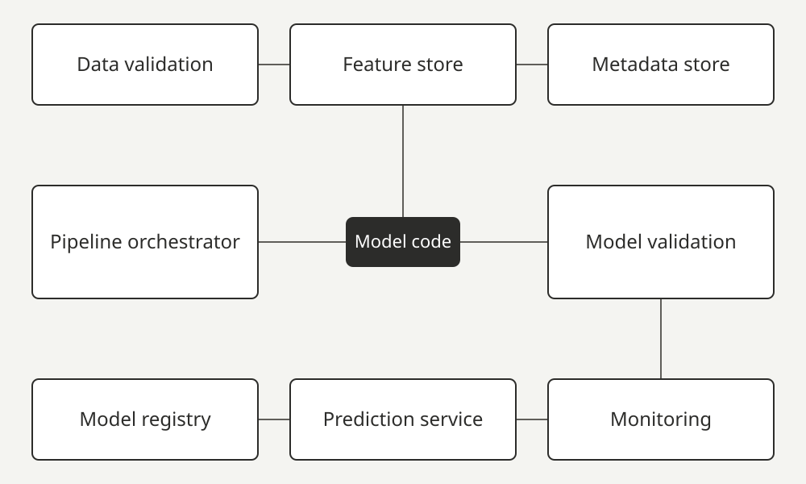

After this lesson you can list the ML-specific forms of technical debt and recognise them in a system you inherit.

## Easy to build, expensive to keep

The 2015 paper "Hidden Technical Debt in Machine Learning Systems" argues that ML systems are fast to build and costly to maintain. "Technical debt" means shortcuts that save time now and cost you interest later. Here the debt sits at the level of the whole system: because the model's behaviour comes from data, it blurs the clean boundaries between parts that ordinary code fixes rely on. [2] Only a small fraction of a real ML system is ML code; the rest is plumbing. [2]

The picture is an illustration, not the paper's figure. The boxes around the model code are components Google lists for automated ML pipelines. [1]

## Forms of debt

**Entanglement.** Everything is tangled together, like pulling one thread in a knitted sweater. Change how one input is spread out, or add or remove a feature (an input the model looks at), and the importance of every other feature can shift. The paper names this the CACE principle: Changing Anything Changes Everything. It extends to hyperparameters, learning settings, sampling and data selection. Mitigations include isolating models, serving ensembles (which only helps when errors are uncorrelated), and detecting changes in prediction behaviour as they happen, for example with per-slice metrics. [2]

**Correction cascades.** Instead of solving problem A properly, a team patches an existing model by training a small extra model on top of it for a slightly different problem. That creates a hidden dependency on the first model, and improving any one component can make the whole system worse. [2]

**Undeclared consumers.** Model outputs written to files, logs or endpoints get used by systems nobody declared. The coupling is hidden, so even improving the model becomes risky. The paper calls this visibility debt, and suggests access restrictions and strict service-level agreements. [2]

**Data dependencies.** Compilers and linkers analyse code dependencies, but comparable tooling for data dependencies is rare. [2]
- *Unstable* inputs change over time, such as another model's output or a signal owned by another team. A mitigation is a frozen, versioned copy of the signal, at the cost of staleness.
- *Underutilized* inputs add little value but make the system fragile. The paper names legacy features, bundled features, ε-features with tiny gains, and correlated features. It suggests leave-one-feature-out evaluations to find them.
- A feature management system that annotates data sources and features lets automated checks resolve dependency trees, which makes migration and deletion safer.

**Feedback loops.** A model can influence its own future training data, directly or, for two systems that affect each other through the world, in hidden ways. Randomisation, or isolating part of the data from the model's influence, can help. [2]

**Anti-patterns.** [2]
- *Glue code*: supporting code around a generic package. The paper suggests a mature system might be at most 5% ML code and at least 95% glue code.
- *Pipeline jungles*: data-preparation pipelines that grow organically into tangles of scrapes, joins and intermediate files.
- *Dead experimental code paths*: experiments kept as conditional branches in production code.
- *Abstraction debt*: ML lacks strong abstractions comparable to the relational database.

**Configuration debt.** In mature systems configuration can exceed code in lines. The paper's principles include making a configuration a small change from a previous one, making manual errors hard, making differences between two configurations easy to see, and code-reviewing configurations and keeping them in a repository. [2]

**The changing world.** Manually chosen decision thresholds can become invalid when a model updates; a mitigation is learning them from held-out data. Live monitoring matters, such as comparing the distribution of predicted labels with observed labels, and putting action limits on real-world actions. [2]

:::low-confidence
The paper's text was read from a plain-text copy of the NeurIPS PDF, because the PDF itself would not parse. Only the abstract was checked against the PDF. The "5% / 95%" figure is the authors' suggestion of what a mature system might look like, not a measurement. [2]
:::

:::key-takeaways
- Most of an ML system is not model code, and most of its debt is at the system level. [2]
- CACE: changing anything changes everything. [2]
- Undeclared consumers, unstable data inputs and feedback loops hide coupling that tests on the model alone will not find. [2]
- Pipeline jungles, glue code and dead experimental paths are signs to look for when you inherit a system. [2]
:::

:::glossary
- **Technical debt**: shortcuts that are quick now but make every later change slower and riskier.
- **Abstraction boundary**: a clean line between two parts so one can change without breaking the other.
- **Feature**: one input the model looks at, such as a customer's age.
- **Weights**: the numbers inside a model that training adjusts; they decide how much each input matters.
- **Hyperparameter**: a setting you choose before training (not learned from data), like how long to train.
- **Ensemble**: several models whose answers are combined.
- **Per-slice metrics**: quality numbers measured separately for each group of data, for example per country.
- **Consumer**: any system or person that uses the model's output.
- **SLA (service-level agreement)**: a written promise about how well a service will behave.
- **Feedback loop**: the model's own output ends up shaping the data it will learn from next.
- **Glue code**: boring code that only connects a library to the rest of your system.
- **Pipeline jungle**: data-preparation steps that grew into an unmaintainable tangle.
- **Held-out data**: example data set aside and never used for training, kept for honest checks.
- **Decision threshold**: the cut-off score above which the model says "yes".
:::
