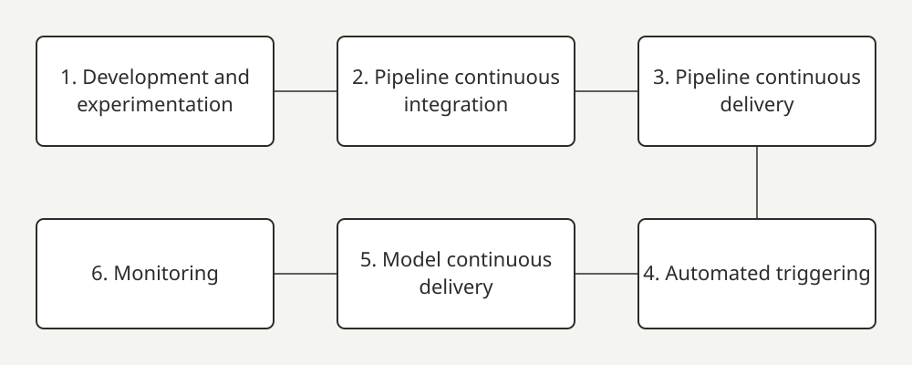

After this lesson you can name the six stages of a Level 2 CI/CD pipeline, say what is delivered at each, and describe how a change moves through test, preproduction and production.

## What is being delivered

At Level 2 two things are delivered: the **pipeline** (the training workflow itself) and the **model** it produces, running as a prediction service (a program other programs call to get predictions). Google's guide shows six stages. [1]

1. **Development and experimentation.** Iteratively try new algorithms and modelling. The output is the source code of the pipeline steps, pushed to a source repository.
2. **Pipeline continuous integration.** Build the code and run tests. The outputs are pipeline components: packages, executables and artifacts.
3. **Pipeline continuous delivery.** Deploy the artifacts to the target environment. The output is a deployed pipeline with the new implementation of the model.
4. **Automated triggering.** The pipeline runs automatically on a schedule or in response to a trigger. The output is a trained model pushed to the model registry.
5. **Model continuous delivery.** Serve the trained model as a prediction service. The output is a deployed prediction service.
6. **Monitoring.** Collect statistics on the model's performance from live data. The output is a trigger to run the pipeline or to start a new experiment cycle.

Data analysis and model analysis remain manual steps in this process. [1]

## Checks at delivery

Google lists the practices for continuous delivery of models. [1]

- Verify the model is compatible with the target infrastructure: packages, memory, compute and accelerators.
- Test the prediction service by calling its API with expected inputs and checking the result.
- Load-test the service for queries per second (QPS) and latency.
- Validate the data used for retraining or batch prediction.
- Verify that models meet predictive performance targets before they are deployed.

## Environments

The guide suggests a promotion path in which the automation level drops as the stakes rise: [1]

| Environment | How it deploys |
| --- | --- |
| Test | Automatically, triggered by pushes to the development branch |
| Preproduction | Semi-automatically, triggered by a merge to the main branch after reviewers approve |
| Production | Manually, after several successful runs of the pipeline in preproduction |

CD4ML adds two operational ideas. Use a delivery orchestrator (a tool that coordinates the ML and application pipelines) with manual approval gates and rollbacks. And treat deployment as more than one model: you may run several at once, shadow models (a new model that receives live requests but whose answers are not used), and competing models in A/B tests or bandits (an automated way of shifting traffic toward whichever version is winning). [14]

## Practical consequences

- A model is promoted by the pipeline, not by a person copying a file. The registry (lesson 14) is the handoff point.
- Human approval is a stage, not an exception. Put it where the risk is: before production, as the guide does.
- Rollback needs a previous model. This is why the run metadata includes a pointer to the previous trained model (lesson 15). [1]

:::key-takeaways
- Six stages: develop, pipeline CI, pipeline CD, automated triggering, model CD, monitoring. [1]
- Automated triggering ends with a trained model pushed to the registry; monitoring ends with a trigger. [1]
- Test deploys automatically, preproduction after approval, production manually after several successful preproduction runs. [1]
:::

:::glossary
- **CD (continuous delivery)**: automatically getting tested changes ready for, or into, a real environment.
- **Pipeline CI / pipeline CD**: building and testing the training workflow, then deploying it.
- **Model CD**: deploying the trained model as a service.
- **Trigger**: an event or schedule that starts a run.
- **Model registry**: the catalogue where trained models are stored for deployment.
- **Prediction service**: the running program that answers prediction requests.
- **Load test**: sending many requests to see how much the service can handle.
- **QPS (queries per second)**: how many requests per second.
- **Latency**: how long one request takes.
- **Accelerators**: special chips (GPUs, TPUs) that speed up model maths.
- **Preproduction / staging**: a near-copy of production used for final checks.
- **Environment**: a separate place code runs (test, preproduction, production).
- **Governance gate**: a required human approval step.
- **Rollback**: returning to the previous version.
- **Shadow model**: a model that sees live requests but whose answers are only recorded.
- **A/B test**: running two versions on live traffic and comparing.
- **Bandit**: an automatic A/B test that sends more traffic to the winning version.
:::
