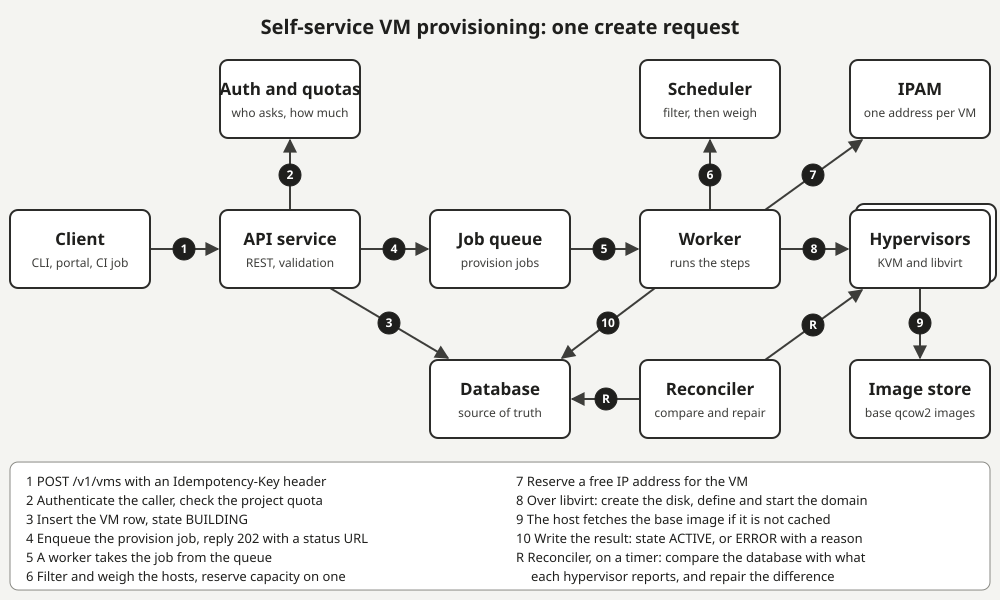

After this lesson you can talk through a VM provisioning service in five steps and answer follow-ups on capacity, placement and crashes.

## The five steps: say them out loud

**Rule:** a design answer is five steps on a clock; numbers come before boxes.

| Step | Minutes | Say out loud |
| --- | --- | --- |
| 1. Requirements and numbers | 5 | "What it does, guarantees, and the load." |
| 2. API | 5 | "Create is slow: 202 and a status URL." [52] |
| 3. Components | 7 | "The database is the source of truth." |
| 4. One request end to end | 5 | "Let me walk one create through." |
| 5. Failures and scaling | 8 | "What breaks at each arrow, and how it heals." |



Step 4: insert the BUILDING row and reserve quota; after commit, enqueue the VM id and return 202; a worker picks a host, claims an IP, creates the disk, starts the domain; it writes ACTIVE or ERROR.

**P1.** You start drawing boxes at once. Which step did you skip, and what can you not justify?

## Capacity arithmetic: the smaller limit wins

**Rule:** VMs per host = the smaller of "fit by CPU" and "fit by RAM".

300 hosts, each 32 cores and 248 GiB free; a VM is 4 vCPUs, 8 GiB; ~2000 creates a day.

```python
cores, ram_gib = 32, 248           # one host
vm_cpu, vm_ram = 4, 8              # one VM
cpu_fit = cores // vm_cpu          # 8
ram_fit = ram_gib // vm_ram        # 31
per_host = min(cpu_fit, ram_fit)   # 8: CPU is the limit
fleet = per_host * 300             # 2400 slots
2000 / fleet                       # 0.83: 83% full, thin headroom
cpu_fit_x4 = cores * 4 // vm_cpu   # 32 with a CPU ratio of 4.0
min(cpu_fit_x4, ram_fit)           # 31: now RAM is the limit
2000 / (8 * 3600)                  # 0.069 creates per second
```

Edge case: CPU overcommit moves the limit to RAM. At 0.07 creates a second, the hard part is correctness, not load.

| Overcommit | Nova default ratio [155] [156] | Cost |
| --- | --- | --- |
| CPU | 4.0 | contention: busy VMs slow down |
| RAM | 1.0 | the OOM killer kills a process [120] |

**P2.** Same hosts; VMs of 2 vCPUs and 16 GiB, no overcommit. How many per host, and what limits it?

## Placement: filter, then weigh, then claim

**Rule:** filter out hosts that cannot fit, rank the rest by a weight [155], then claim the slot with a conditional write.

```python
used = {"kvm-1": 2, "kvm-2": 6, "kvm-3": 8}   # VMs on each host
slots = 8                                       # capacity per host
fits = [name for name in used if used[name] < slots]  # ['kvm-1', 'kvm-2']
min(fits, key=used.get)   # spread, the emptiest:        'kvm-1'
max(fits, key=used.get)   # pack, the fullest that fits: 'kvm-2'
# all full -> fits == [] -> no host
```

| Choice | Picks | Good for |
| --- | --- | --- |
| spread | emptiest | general VMs: one host failure takes fewer |
| pack | fullest that fits | short CI VMs: leaves whole hosts empty |

Two workers can both see "kvm-2 has one slot". A conditional write settles it (run on SQLite):

```sql
UPDATE hosts SET used = used + 1
 WHERE name = 'kvm-2' AND used + 1 <= total;
-- worker A: 1 row updated -> slot is A's
-- worker B: 0 rows        -> try the next host
```

**P3.** With `used = {"kvm-1": 7, "kvm-2": 3}` and 8 slots, which host does pack choose? And spread?

## Failures: desired vs actual state

**Rule:** the database holds desired state, each host reports actual state, and a reconciler loop moves actual towards desired, like a thermostat [160].

`kill -9` gives a worker no chance to mark its job failed [50]. So every step is check-then-act; a rerun skips what is done:

```text
claim host            host set? yes    skip
claim IP              IP set?   yes    skip
disk                  exists?   yes    skip
domain                defined?  no     define it
running               running?  no     start it
```

| Database (desired) | Host (actual) | Action |
| --- | --- | --- |
| ACTIVE | no domain | ERROR and alert; never recreate silently |
| no row | domain exists | orphan: shut down after a grace period |
| BUILDING, stale 15 min | anything | re-enqueue the idempotent job |

Edge case: a slow host can look empty. Act only on a difference seen twice.

**P4.** On one pass, kvm-9 reports no domains, but the database lists 12 ACTIVE VMs there. What does the reconciler do?

## Exercise (20 minutes)

Close this page. With a timer, say the five steps aloud while sketching; then compare with `vm-provisioning.svg`.

## Cheat sheet

| Tool | Rule | Tiny example → result |
| --- | --- | --- |
| capacity | min(CPU fit, RAM fit) | min(8, 31) → 8 |
| placement | filter, weigh | spread `{2, 6}` → the 2 |
| reconcile | desired vs actual | ACTIVE, no domain → ERROR |

## Answers

**P1.** Step 1: without numbers you cannot justify one database or an overcommit ratio.

**P2.** 15: CPU fits 32 / 2 = 16, RAM fits 248 / 16 = 15. RAM is the limit.

**P3.** Pack picks kvm-1 (7 used, still fits); spread picks kvm-2.

**P4.** Nothing yet: the host may have answered slowly. Seen again, it marks them ERROR and alerts.

**R1.** 31: CPU allows 32, RAM 31.

**R2.** 0 rows: B lost and tries the next host.

**R3.** The database: desired state.

**R4.** Skip the disk, define and start the domain.

## If you missed a quiz question

| If you thought... | Reread | Re-check |
| --- | --- | --- |
| Capacity is one resource's limit | Capacity | **R1.** 4 vCPU/8 GiB, CPU ratio 4.0? |
| Reading "has room" is enough | Placement | **R2.** B's `UPDATE` returns? |
| Host or queue is the truth | Failures | **R3.** Which side is desired? |
| A rerun redoes or skips everything | Failures | **R4.** Disk exists, no domain? |

:::key-takeaways
- Five steps, numbers first; per host, min(CPU fit, RAM fit); RAM stays at 1.0. [120] [155]
- Placement: filter, weigh, claim with a conditional write.
- Steps are check-then-act; a reconciler repairs drift seen twice. [160]
:::

:::glossary
- **Source of truth**: the one place whose data wins when two places disagree.
- **Overcommit**: promising VMs more CPU or memory in total than the host has.
- **OOM killer**: the part of Linux that kills a process when memory runs out.
- **Nova**: OpenStack's compute service, a reference design.
- **Orphan**: a VM running on a host that the database does not know about.
- **Reconciler**: a loop that compares what should exist with what does, and fixes the gap.
- **Domain**: libvirt's word for one virtual machine.
:::
